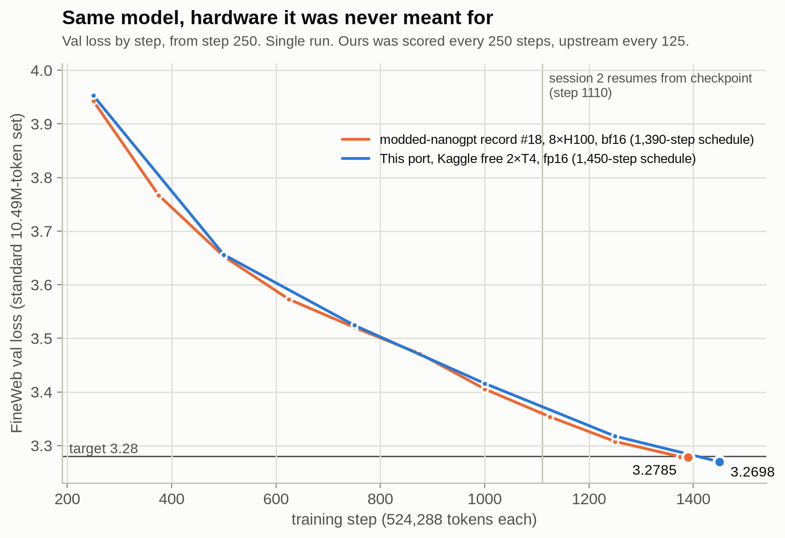

# Zero-Dollar Speedrun

The modded-nanogpt GPT-2-small speedrun, ported to the free GPUs anyone can get: Kaggle's 2×T4.

## Result

In a single run on Kaggle's free 2×T4 tier, costing $0, our fp16 port of the modded-nanogpt GPT-2-small speedrun
model (record #18, 2025-01-04 SoftCap) reached **3.2698 FineWeb validation loss** on the standard 10.49M-token val
set, below the speedrun's 3.28 target. It took 1,450 steps and 760M training tokens (4.3% more than the 8×H100
record's 729M) and 15.4 Kaggle session-hours (30.8 T4-hours) across two sessions (11.7 h + 3.7 h) joined by a
checkpoint resume.

- 1,450 steps = 1,449 optimizer updates. One fp16 overflow step (step 1006) was skipped.
- The model is the speedrun's GPT-2-small (124M-class) architecture: 275.7M parameters counting the token
  embedding and three 50304×768 value-embedding tables, 121.2M without them.
- Val set: the first 10,485,760 tokens of `fineweb_val_000000.bin` (sha256 `5b95c8e0…1640`), scored as 160
  independent 65,536-token sequences, exactly as upstream.
- Re-scored outside training: a fresh process on 2×T4 loaded the saved final checkpoint and got 3.2698315 in fp16
  (identical to the logged value) and 3.2698309 in fp32. See [receipts/rescore.json](receipts/rescore.json).
- Every number above maps to a file and a field in [receipts/README.md](receipts/README.md).
  `python3 receipts/verify.py` re-derives them (stdlib only).



## Quickstart: clone to a Kaggle run

You need a Kaggle account with phone verification (Kaggle's rule for GPU and internet in notebooks). Get your token
from kaggle.com → Settings → API → Create New Token, and save the `kaggle.json` it downloads as
`~/.kaggle/kaggle.json` (`chmod 600`). If Kaggle gives you a token string instead of a file, put
`KAGGLE_USERNAME=<you>` and `KAGGLE_API_TOKEN=<token>` in `~/.config/zds/env` (that is how the run here was
launched). Then:

```sh
git clone https://github.com/BharatBheesetti/zero-dollar-speedrun-public zero-dollar-speedrun && cd zero-dollar-speedrun
make venv                                                        # CPU torch + numpy, pytest, tiktoken, kaggle
ZDS_KAGGLE_LEDGER_OK=1 .venv/bin/python lanes/kaggle_push.py smoke
```

`smoke` uploads `trainer/` + `scripts/` as a private Kaggle dataset and pushes a private notebook that trains 300
steps on 2×T4 (about 2.7 h, 3 h cap). At steps 125 and 250 it validates on upstream's exact schedule, so you can
compare against upstream's 4.3686 and 3.9427. `ZDS_KAGGLE_LEDGER_OK=1` confirms you mean to spend GPU quota (the
lane refuses live commands without it). Kaggle gives about 30 GPU-hours a week.

The full run is `full`, then `chain` for the second session:

```sh
ZDS_KAGGLE_LEDGER_OK=1 .venv/bin/python lanes/kaggle_push.py full --skip-dataset              # session 1, 12 h cap
ZDS_KAGGLE_LEDGER_OK=1 .venv/bin/python lanes/kaggle_push.py status --mode full --session 1   # wait for COMPLETE
ZDS_KAGGLE_LEDGER_OK=1 .venv/bin/python lanes/kaggle_push.py chain --session 2 --skip-dataset # resumes s1's checkpoint
ZDS_KAGGLE_LEDGER_OK=1 .venv/bin/python lanes/kaggle_push.py pull --mode full --session 2     # -> out/kaggle/zds-full-s2/
```

Each session checkpoints every 20 minutes and stops itself 20 minutes before Kaggle's 12 h cap. The next session
attaches the previous one's output and continues from its newest committed checkpoint. `lanes/autochain.py` does
the wait-and-chain step unattended. More in [lanes/README.md](lanes/README.md).

## No Kaggle? Run it on CPU

The `--tiny` preset is the same 12-layer topology at width 96 on synthetic data. It exercises the whole training
path (both optimizers, schedules, checkpoints, validation) in about a minute on a laptop. `make test` adds resume,
2-rank DDP and the fp16 GradScaler path:

```sh
make venv
make smoke                     # 60 tiny steps on CPU; loss falls from ~8.3 to ~2.0; writes out/smoke/
.venv/bin/python scripts/rescore.py --ckpt out/smoke/ckpt/ckpt_0000061.pt --tiny --device cpu   # re-score it
make test                      # 56 tests (3 skip without data/), ~4 min; includes kill -9 mid-run + resume
make dry-shape                 # the full 275.7M config: one step on random tokens, params + peak memory (~5.4 GB)
```

`make data N=1` downloads the real FineWeb val shard plus one train shard (~400 MB) if you want to check the val
set hash: `tests/test_data.py` runs once `data/` exists.

## What is pinned, and what isn't

- **Code.** `trainer/train_t4.py` in this repo is byte-identical to the file both training sessions and the
  re-score ran (sha256 `ff541245…8312`, checked by `receipts/verify.py`).
- **Seed.** `--seed 0` (the default). GPU training is not bit-deterministic (`deterministic: false` in the log's
  `start` record), so a rerun will not land on exactly 3.2698.
- **Software.** The run used the torch that Kaggle's image ships, 2.11.0+cu128; the image digest is in
  `receipts/zds-full-s{1,2}/kernel-metadata.json` (`docker_image`). The lane does not pin it: you get whatever
  image Kaggle serves the day you run.
- **Data.** `scripts/get_data.py` downloads from `kjj0/fineweb10B-gpt2` at `main` (no revision pin). The val file's
  sha256 and the sha256 of the scored tokens are checked against pinned values on every run. Train shards 1–8 are
  checked by header and size only.
- **Local.** `make venv` installs unpinned packages. The CPU path was last run from a fresh clone on 2026-11-17
  with Python 3.12.3, torch 2.15.0+cpu and numpy 2.5.5.

## What's different from upstream

Upstream is [KellerJordan/modded-nanogpt](https://github.com/KellerJordan/modded-nanogpt) at `4ea6b937`, record #18
(`records/track_1_short/2025-01-04_SoftCap`): 3.2785 after 1,390 steps (728.8M tokens) on 8×H100. We ported record
#18, not the current record: later records need FlashAttention-3, FP8 and a 65B-parameter n-gram table, none of
which runs on a T4. [trainer/PORTING.md](trainer/PORTING.md) goes through it feature by feature. The changes:

- **fp16, not bf16.** T4 has no bf16 tensor cores. We use fp16 autocast with fp32 master weights and a GradScaler.
  The embedding tables stay fp32 (upstream stores them in bf16). Muon's Newton-Schulz runs in fp32.
- **No FlexAttention.** Torch SDPA with a boolean mask that is exactly upstream's document-causal sliding window.
- **8K-token pieces.** Each 65,536-token sequence is trained as eight 8,192-token pieces with gradient
  accumulation, because 64K tokens of activations don't fit in 15 GB. Attention can't see across a piece
  boundary, so about 12% of scored training tokens have a shorter receptive field than upstream's. Validation is
  unaffected: it runs on whole 65,536-token sequences.
- **1,450 steps, not 1,390.** Upstream's own 80 reruns of #18 average 3.2791 ± 0.0019, and only 69% reach 3.28. We
  get one run with an untested port, so we fixed 60 extra steps (+4.3% tokens) before spending any GPU time. The LR
  cooldown and window schedule stretch to the new length.
- **One all-reduce per step, no torch.compile.** Plain DDP replaced by one flat fp32 all-reduce. Compile is off
  (on SM75 it only fuses pointwise ops).
- **Checkpoints and resume.** Atomic checkpoints of the full training state (model, both optimizers, GradScaler,
  data position, RNG) every 20 minutes and on SIGTERM. `--resume` continues from the newest committed one. On CPU,
  `make test` kills a run with `kill -9` and checks that the resumed losses equal the uninterrupted run's.
- **Claims bookkeeping.** The log records the val file's sha256, the sha256 of the exact tokens scored, and whether
  both equal upstream's pinned values (`val_set_is_upstream`).

## Limitations

- **One run.** Upstream's run-to-run SD for #18 is 0.0019 over 80 runs. Our margin under 3.28 is 0.0102, but our
  own SD is unmeasured.
- **4.3% more tokens than the record.** We have no val at step 1,390. The receipts can't show this port reaches 3.28
  on upstream's 729M-token budget, and at matched steps we trail upstream by 0.003–0.010.
- **A port, not a reproduction.** fp16, fp32 embeddings and 8K pieces all change the dynamics a little. This is not
  a speedrun record: those require 8×H100 and enough runs for p<0.01.
- **One fp16 overflow skip.** It happened at step 1006, so 1,450 steps made 1,449 updates.
- **275.7M parameters.** "124M" counts only the non-embedding weights of standard GPT-2. This architecture adds
  three value-embedding tables.
- **The resume was planned.** Session 1 stopped on its time budget and session 2 resumed it on a fresh machine.
  No GPU crash-and-resume has been tested. The kill -9 test runs on CPU.
- **Slow.** About 36 s per step, 14.5k tokens/s, roughly 10% of T4 fp16 peak. Record #18's training loop takes
  3.4 minutes on 8×H100 (0.45 H100-hours). This run took 15.4 hours of wall-clock, about 270 times longer, and
  30.8 T4-hours.
- **Weights are not published.** The Kaggle notebooks and their outputs (3 GB checkpoints, the 1.1 GB
  model-only file) sit in a private Kaggle account. This repo has their logs, metadata and sha256s, which you
  have to take on trust until the weights are public.
- **$0 means the compute bill.** Kaggle pays for the GPUs. A laptop ran the watcher that chained the two
  sessions. No training ran on it.

## Repo map

| Path | What |
|---|---|
| `trainer/train_t4.py` | the whole trainer, one file |
| `trainer/PORTING.md` | upstream feature → kept / changed / dropped |
| `scripts/get_data.py` | FineWeb10B GPT-2 shards from Hugging Face (`kjj0/fineweb10B-gpt2`) |
| `scripts/rescore.py` | score a saved checkpoint in a fresh process with the trainer's own `validate` |
| `lanes/` | Kaggle lane: pack, push, chain, pull |
| `receipts/` | logs, kernel metadata and hashes behind every number |
| `LEADERBOARD.md` | the "your bill is zero" leaderboard rules |
| `tests/` | `make test`, CPU only |

`scripts/rescore.py` is kept byte-identical to the file that ran, so its docstring still cites a development
review note. The git SHAs in `receipts/*/kernel.log` are from the development history; this repo starts from a fresh one.

## Credits

The model, optimizer, schedule and val protocol are [modded-nanogpt](https://github.com/KellerJordan/modded-nanogpt)'s,
by Keller Jordan and its contributors (MIT). Record #18 is by Braden Koszarsky
([KoszarskyB](https://github.com/KoszarskyB)). Muon is from the same project. The tokenized
FineWeb shards are upstream's (`kjj0/fineweb10B-gpt2` on Hugging Face), built from Hugging Face's FineWeb. The
speedrun itself descends from Andrej Karpathy's llm.c GPT-2 reproduction. All the free compute is Kaggle's.
